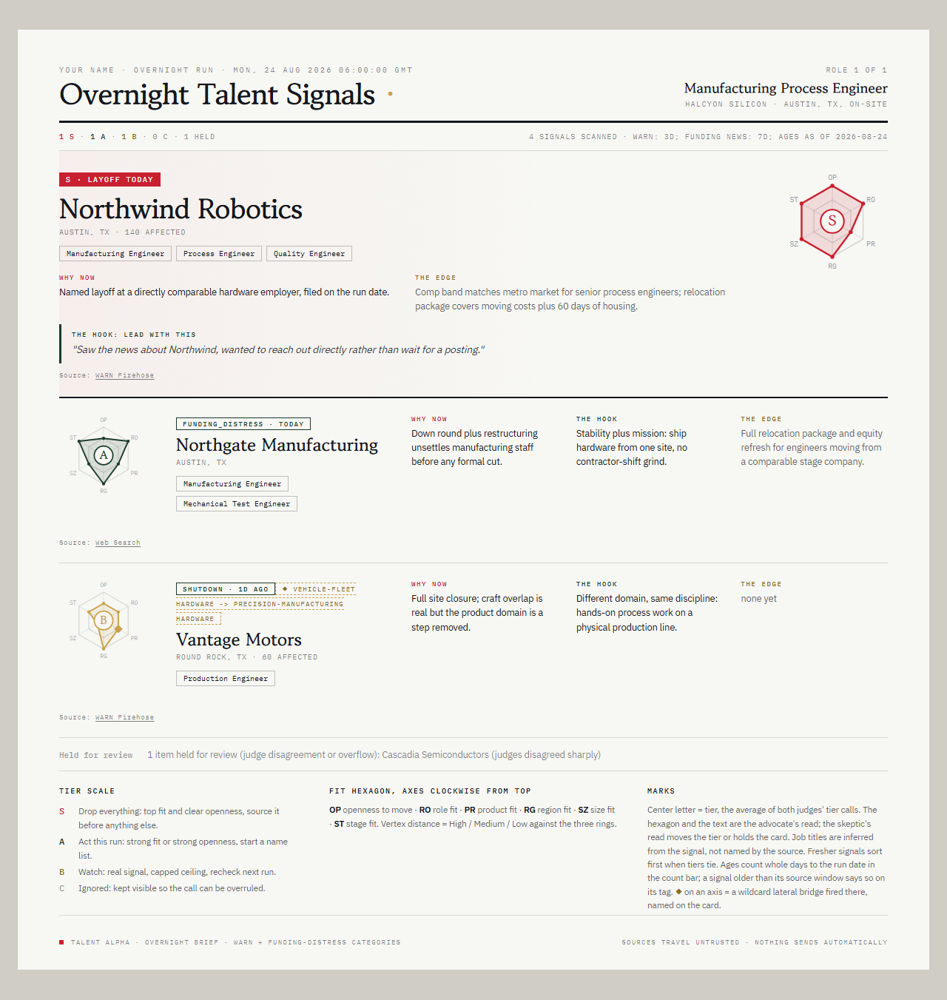
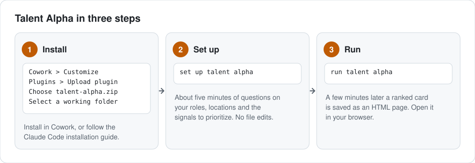
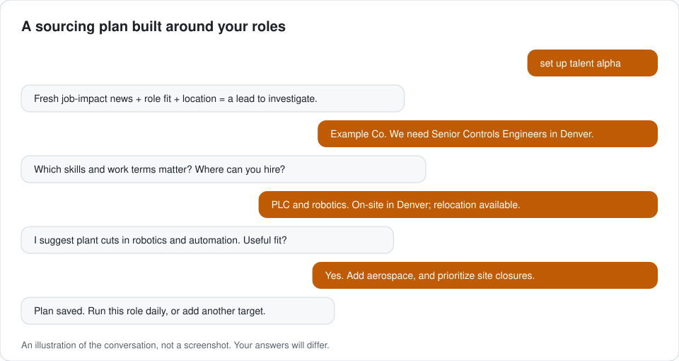
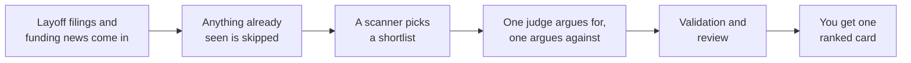

<div align="center">

# Talent Alpha

**For recruiters and sourcers:** a short, ranked card of companies with fresh layoff or funding news, the job functions likely affected, and a line to open with.

[](CHANGELOG.md)
[](#run-it-every-night-without-you)
[](LICENSE)

by [OnePromptMan](https://github.com/onepromptman) · © 2026

</div>



<sub>A sample card, made from fictional companies. Yours arrives as one HTML page you open in a browser.</sub>

Agent pack (Claude plugin) and No-code (n8n) · No coding, some setup · Live · MIT

## What you get

- **A ranked card.** Companies are graded S, A, B or C for how well their news fits the role you are filling.
- **A reason and an opener.** Each company comes with why now, source links and a draft first line.
- **Only what is new.** Run it again another day and it shows only events you have not seen.

Talent Alpha never contacts candidates. The card names companies and job functions, never people. You decide who to reach out to.

## Get started



1. **Install.** In Cowork, open **Customize > Plugins** and upload the Talent Alpha
   plugin ZIP, or add the `onepromptman/talent-alpha` marketplace. Choose a working
   folder for your saved roles and cards. Claude Code instructions are also in
   [installation](docs/INSTALL.md).
2. **Set up.** Type `set up talent alpha` and answer the questions. About five minutes.
3. **Run.** Type `run talent alpha`. A few minutes later a card is saved as an HTML file in your working folder. Open it in a browser.

**What you need:** Claude Code or Cowork with web search turned on, and Python 3.10
or later in its execution environment. Setup checks this for you. No API key.
The full pipeline needs Cowork or Claude Code; ordinary chat cannot run its agents.

## Setup is a conversation



Setup explains what makes a signal worth investigating today, then asks which
roles and locations you want to target. It proposes relevant industries and
triggers from the role, checks remote or relocation terms, and saves your
confirmed plan. You do not have to design the news filters yourself.

For example, a nearby plant closure might justify researching process engineers.
A successful funding announcement alone does not establish that people are
available. The current feeds cover layoffs, closures and funding distress.
Your role, skills, geography and actual offer determine which signals matter.

Save several roles, then say `run talent alpha for <role>` or `run all my targets`.
Each gets its own card and memory, so an event reviewed for one role can still be
considered for another. Daily runs reuse the saved settings. Your shared profile
is `onepromptman-profile.md`; saved targets are in `talent-alpha-targets.json`.

## See it before you install

Download this repository as a ZIP, unzip it, and open `samples/01_Overnight_Card_SAMPLE.html` in your browser. It is a fictional card and needs no account.

## How it works



## What it asks of your data

- Your profile and the news go to Anthropic (in your Claude session, or by API in n8n).
  n8n also pulls from WARN Firehose and Perplexity and emails the card to your Gmail.
- Keep employee and candidate names out of your profile: they are personal data.
- The profile, state file and cards stay in your working folder; delete them to delete
  the data. In n8n, clear the Data Table and old executions.

## If something goes wrong

- **`run talent alpha` does nothing.** You are in the regular chat window. Use Claude Code
  or Cowork.
- **Setup says web search is missing.** Turn on web search for your Claude client, or use a
  session that has it. The plugin finds news by web search and will not guess without it.
- **The card repeats old events.** The plugin ran from a different working folder and missed
  its state file. Run it from the same folder each time.

## Run it every night without you

An n8n workflow ships in this repository for a nightly card by email. It is a preview until its [acceptance cases](docs/ACCEPTANCE.md) pass in your own n8n account.

| | The plugin | The n8n workflow |
| --- | --- | --- |
| Runs in | Claude Code or Cowork, when you ask | n8n, Cloud or self-hosted, nightly |
| You'll need | Claude Code or Cowork with web search, plus Python 3.10+ | Anthropic and Gmail; WARN Firehose for layoffs/closures, Perplexity for funding news. Disabled sources need no credential. |
| Each run costs | Model use on your plan: a scanner, two judges, a checker | A scanner and two judges, billed to your Anthropic account |
| Layoff source | Web search (shown as Reported) | Official WARN filings (shown as Filed) |

To try it, import `n8n/talent-alpha-demo.workflow.json`, add an Anthropic credential and
click **Execute Workflow**. It uses sample signals, sends no email and writes no Data Table.
The full setup is [docs/setup.md](docs/setup.md), and [CONNECTORS.md](CONNECTORS.md)
explains the tradeoff between the two sources.

<details>
<summary><b>n8n troubleshooting and upgrades</b></summary>

- The card repeats old events: pick the Data Table on **Skip Already-Scanned Events** and
  **Record Scanned Events**.
- No card arrives: open the run in n8n's execution list, which is its log. The free WARN
  key allows 25 calls a day.
- **Upgrading an earlier copy of the workflow?** Its dedupe Data Table is now
  `talent_alpha_events_seen` (it was `r04_events_seen`). Rename yours, keeping its rows,
  before the next scheduled run, or the next card repeats old events.
  [Steps](docs/setup.md#upgrading-an-existing-install).

</details>

<details>
<summary><b>For engineers</b></summary>

Claude Code marketplace install:

```text
/plugin marketplace add onepromptman/talent-alpha
/plugin install talent-alpha@talent-alpha
```

To build a checked sample yourself, run `python tools/demo.py` from this folder with Python 3.10 or newer, then open `talent-alpha-demo/card.html`. It uses prepared fictional inputs, needs no keys or extra packages, and makes no model or news requests. The local scripts show their errors in the terminal.

Repeatable setup, expected outputs, failure cases and separate model/platform runs are in [the acceptance plan](docs/ACCEPTANCE.md). Custom templates must preserve the shipped data slots and hero/card markers. A malformed template stops the build before the card or seen-event state changes.

### Settings

| Setting | Default | What it does |
| --- | --- | --- |
| `onepromptman-profile.md` | written by setup | Your company, the open role, sectors, card size |
| `talent-alpha-state.json` | next to the profile | Events already shown; its path is in the profile |
| n8n **Config** node | sample values | Role, sourcing criteria, sectors, offer, card limit, enabled feeds and role memory |
| `LOG_LEVEL` | `WARNING` | `INFO` or `DEBUG` shows what the scripts did |
| `LOG_FORMAT`, `LOG_FILE` | text, standard error | JSON lines, or append to a file |

From this folder:

```bash
python3 -m pip install -r requirements-dev.txt
python3 -m pytest -q
```

`agents/` holds the scanner, judges and checker, `skills/` the orchestrator and setup,
`n8n/` the workflows. The version is in `MODULE.yaml` and the plugin manifest, with
changes in [CHANGELOG.md](CHANGELOG.md). Model tiers, state and scheduling:
[docs/how-it-works.md](docs/how-it-works.md).

### Standalone maintenance

This repository is the home of Talent Alpha. Changes are made here. See [CONTRIBUTING.md](CONTRIBUTING.md).

The plugin validates cards before recording seen IDs. The n8n deployment uses two judges and deterministic validation; its code and export builder live in `n8n/`.

</details>

## License

MIT. See [LICENSE](LICENSE). Every card is a draft for a person to review. Questions or
bugs? Open an [issue](../../issues).
