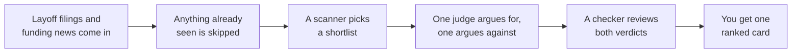

<div align="center">

# Talent Alpha

**For recruiters and sourcers:** one short, ranked card of people who just became reachable because their employer announced layoffs or ran low on money, with why now, what to say, and why your role beats their next option.

[](CHANGELOG.md)
[](#where-it-runs)
[](LICENSE)

by [OnePromptMan](https://github.com/onepromptman) · © 2026

</div>

Agent pack (Claude plugin) and No-code (n8n) · No coding, some setup · In prep · MIT

> **Upgrading an earlier copy of the n8n workflow?** Its dedupe Data Table is now
> `talent_alpha_events_seen` (it was `r04_events_seen`). Rename yours, keeping its rows,
> before the next scheduled run, or the next card repeats old events.
> [Steps](docs/setup.md#upgrading-an-existing-install).

## Where it runs

| | The plugin | The n8n workflow |
| --- | --- | --- |
| Runs in | Claude Code or Cowork (the Claude desktop app), not the regular chat window | n8n, Cloud or self-hosted, nightly |
| You'll need | A Claude plan that includes Claude Code or Cowork. Nothing else. | An Anthropic API key, Gmail, a free WARN Firehose key; Perplexity optional |
| Each run costs | Model use on your plan: a scanner, two judges, a checker | A scanner and two judges, billed to your Anthropic account |

The plugin finds layoffs by web search (shown as Reported); n8n reads official WARN
filings (shown as Filed). [CONNECTORS.md](CONNECTORS.md) explains the tradeoff.

## How it works



## First run

1. Open Claude Code or Cowork and add the plugin:
   ```
   /plugin marketplace add onepromptman/talent-alpha
   /plugin install talent-alpha@talent-alpha
   ```
2. Type `set up talent alpha`. It asks about your company, the role you are filling and
   the industries to watch, one question at a time. Any question can be skipped. About
   five minutes.
3. Type `run talent alpha`. A few minutes later a card is saved as an HTML file in your
   working folder. Open it in a browser.
4. Run it again another day: the card shows only events you have not seen.

To try the n8n version first, import `n8n/talent-alpha-demo.workflow.json`, add an
Anthropic credential and click **Execute Workflow**. It uses sample signals, sends no
email and writes no Data Table. The full setup is [docs/setup.md](docs/setup.md).

Talent Alpha never contacts anyone. The card names companies and job functions, never
people; you decide who to reach out to.

## What it asks of your data

- Your profile and the news go to Anthropic (in your Claude session, or by API in n8n).
  n8n also pulls from WARN Firehose and Perplexity and emails the card to your Gmail.
- Keep employee and candidate names out of your profile: they are personal data.
- The profile, state file and cards stay in your working folder; delete them to delete
  the data. In n8n, clear the Data Table and old executions.

## Settings

| Setting | Default | What it does |
| --- | --- | --- |
| `onepromptman-profile.md` | written by setup | Your company, the open role, sectors, card size |
| `talent-alpha-state.json` | next to the profile | Events already shown; its path is in the profile |
| n8n **Config** node | sample values | `targetSectors`, `companyProfile`, `openRole` |
| `LOG_LEVEL` | `WARNING` | `INFO` or `DEBUG` shows what the scripts did |
| `LOG_FORMAT`, `LOG_FILE` | text, standard error | JSON lines, or append to a file |

## When something goes wrong

- `run talent alpha` does nothing: you are in the regular chat window. Use Claude Code
  or Cowork.
- The card repeats old events: the plugin ran from another working folder and missed
  its state file. In n8n, pick the Data Table on **Skip Already-Scanned Events** and
  **Record Scanned Events**.
- No n8n card: open the run in n8n's execution list, which is its log. The free WARN
  key allows 25 calls a day. Plugin scripts log to standard error or `LOG_FILE`.

## For engineers

From this folder:

```bash
python3 -m pip install pytest
python3 -m pytest -q
```

`agents/` holds the scanner, judges and checker, `skills/` the orchestrator and setup,
`n8n/` the workflows. The version is in `MODULE.yaml` and the plugin manifest, with
changes in [CHANGELOG.md](CHANGELOG.md). Model tiers, state and scheduling:
[docs/how-it-works.md](docs/how-it-works.md).

## Built from source

This repository is generated from the `talent-alpha` module of onepromptman/talentai, the
OnePromptMan recruiting system, by its publish script `tools/publish/talent-alpha.sh`. This
copy is module version 1.3.0, module tree `af6f34d09ee16f845c3ff5f9096e27039bddd0e6`. A change made only here is
replaced by the next publish, so changes are made in the module; see
[CONTRIBUTING.md](CONTRIBUTING.md).

**Coming from the earlier talent-alpha repository?** Follow the upgrade note at the
top. That repository's four public forks are detached copies of its first commit and
do not receive these updates.

## License

MIT. See [LICENSE](LICENSE). Every card is a draft for a person to review. Questions or
bugs? Open an [issue](../../issues).
